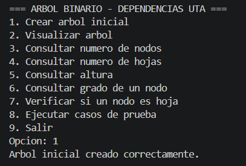
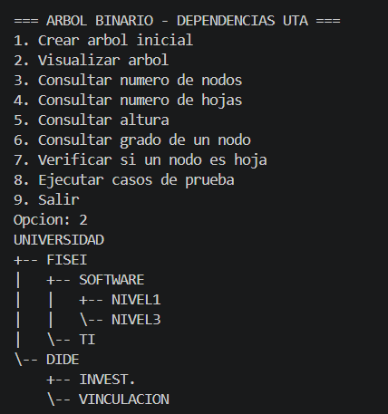
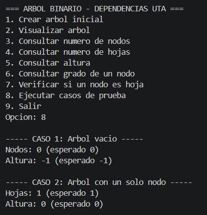
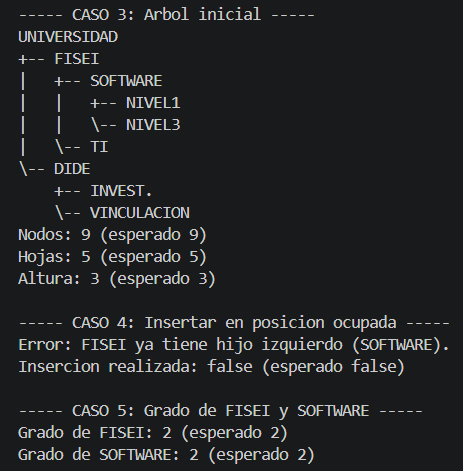
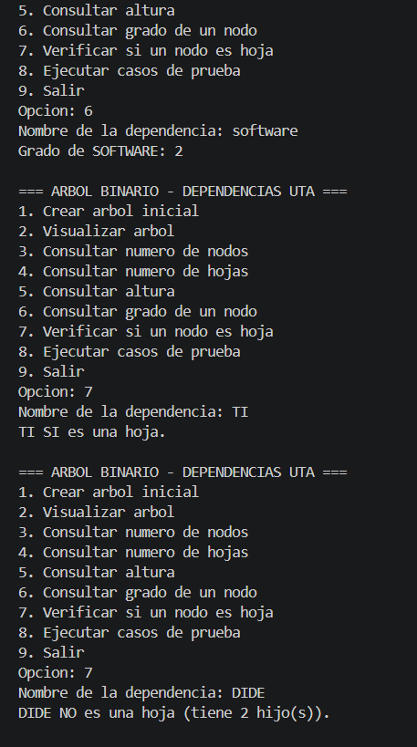
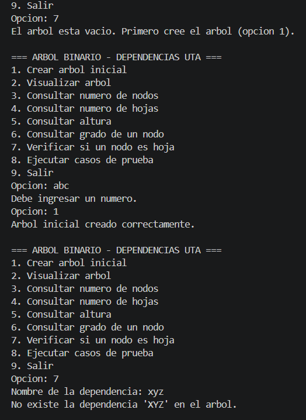

# T6 - Árbol Binario en Java

**Asignatura:** Estructura de Datos  
**Nivel:** Tercero – Ingeniería de Software, FISEI - UTA  
**Estudiante:** Rommel Gamboa  
**Modalidad:** Individual  
**Herramientas:** Java, Visual Studio Code y GitHub

---

## Problema

La Universidad necesita representar la organización jerárquica de sus dependencias académicas. Para ello se utiliza un **árbol binario**, en el que cada nodo almacena el nombre de una dependencia y tiene como máximo dos hijos.

La aplicación permite **construir, visualizar y analizar** esta estructura: contar nodos y hojas, calcular la altura, consultar el grado de un nodo y verificar si un nodo es hoja.

---

## Estructura del árbol

```
             UNIVERSIDAD
             /         \
       FISEI             DIDE
       /   \             /   \
   SOFTWARE  TI     INVEST.  VINCULACION
    /   \
  NIVEL1 NIVEL3
```

| Propiedad | Valor |
|---|---|
| Raíz | UNIVERSIDAD |
| Total de nodos | 9 |
| Hojas | 5 (NIVEL1, NIVEL3, TI, INVEST., VINCULACION) |
| Nodos internos | 4 (UNIVERSIDAD, FISEI, DIDE, SOFTWARE) |
| Altura | 3 aristas (UNIVERSIDAD → FISEI → SOFTWARE → NIVEL1) |

---

## Organización del proyecto

```
T6-ArbolBinario-GamboaRommel/
├── img/                         -> Capturas de ejecución
├── src/
│   ├── modelo/
│   │   └── Nodo.java            -> Nodo genérico: dato, hijos, esHoja(), grado()
│   ├── negocio/
│   │   └── ArbolBinario.java    -> Inserción, conteos, altura, búsqueda y visualización
│   └── app/
│       └── Main.java            -> Menú interactivo con Scanner y casos de prueba
├── .gitignore
└── README.md
```

---

## Implementación

### Clase `Nodo<T>` (paquete `modelo`)

| Elemento | Descripción |
|---|---|
| `dato` | Información almacenada (nombre de la dependencia) |
| `izquierdo` / `derecho` | Referencias a los hijos |
| `esHoja()` | Devuelve `true` si el nodo no tiene hijos |
| `grado()` | Devuelve el número de hijos (0, 1 o 2) |
| Getters y setters | Acceso a los atributos |

### Clase `ArbolBinario<T>` (paquete `negocio`)

| Método | Descripción |
|---|---|
| `crearRaiz(dato)` | Crea el nodo raíz |
| `agregarIzquierdo(padre, dato)` | Agrega un hijo izquierdo; devuelve `false` si la posición está ocupada |
| `agregarDerecho(padre, dato)` | Agrega un hijo derecho; devuelve `false` si la posición está ocupada |
| `contarNodos()` | Cuenta el total de nodos (recursivo) |
| `contarHojas()` | Cuenta los nodos sin hijos (recursivo) |
| `altura()` | Calcula la altura en aristas (recursivo) |
| `esVacio()` | Verifica si el árbol no tiene raíz |
| `buscar(dato)` | Localiza un nodo por su nombre, en preorden (recursivo) |
| `mostrarArbol()` | Imprime el árbol con sangría según el nivel (recursivo) |

**Uso de la recursividad:** cada operación pública llama a un método privado que recibe el nodo actual. Por ejemplo, para contar nodos:

```java
private int contarNodos(Nodo<T> nodo) {
    if (nodo == null) return 0;                    // caso base
    return 1 + contarNodos(nodo.getIzquierdo())    // subárbol izquierdo
             + contarNodos(nodo.getDerecho());     // subárbol derecho
}
```

**Altura en aristas:** el caso base devuelve `-1` para un nodo nulo. Así, una hoja tiene altura `1 + max(-1, -1) = 0` y un árbol vacío tiene altura `-1`.

### Complejidad

| Operación | Complejidad |
|---|---|
| `crearRaiz`, `agregarIzquierdo`, `agregarDerecho`, `esVacio` | O(1) |
| `esHoja`, `grado` | O(1) |
| `contarNodos`, `contarHojas`, `altura`, `buscar`, `mostrarArbol` | O(n), recorren cada nodo una vez |

### Restricciones cumplidas

- Código organizado en los paquetes `modelo`, `negocio` y `app`.
- No se utiliza `TreeSet`, `TreeMap`, `PriorityQueue`, `NavigableSet` ni `NavigableMap`.
- Conteo de nodos, conteo de hojas y altura implementados con **recursividad**.
- Interacción con el usuario mediante `Scanner`.

---

## Instrucciones de ejecución

**Requisitos:** JDK 8 o superior y Git.

```bash
git clone https://github.com/gamboarommel580-rgb/T6-ArbolBinario-GamboaRommel.git
cd T6-ArbolBinario-GamboaRommel
javac -encoding UTF-8 -d bin src/modelo/*.java src/negocio/*.java src/app/*.java
java -cp bin app.Main
```

### Menú

| Opción | Acción |
|---|---|
| 1 | Crear árbol inicial |
| 2 | Visualizar árbol |
| 3 | Consultar número de nodos |
| 4 | Consultar número de hojas |
| 5 | Consultar altura |
| 6 | Consultar grado de un nodo |
| 7 | Verificar si un nodo es hoja |
| 8 | Ejecutar casos de prueba |
| 9 | Salir |

> Primero se debe elegir la opción **1** para construir el árbol. Los nombres de las dependencias pueden escribirse en minúsculas, porque el programa los convierte a mayúsculas.

### Validaciones

- Si se intenta insertar en una posición ocupada, la inserción se rechaza con un mensaje de error.
- Si se consulta una dependencia que no existe, se informa al usuario.
- Si se consulta un nodo antes de crear el árbol, se pide crearlo primero.
- Si se escribe un valor no numérico en el menú, el programa lo vuelve a pedir sin cerrarse.

---

## Resultados y casos de prueba

### Casos obligatorios (opción 8)

| # | Caso | Esperado | Obtenido |
|---|---|---|---|
| 1 | Árbol vacío | 0 nodos, altura -1 | 0 nodos, altura -1 ✔ |
| 2 | Árbol con un solo nodo | 1 hoja, altura 0 | 1 hoja, altura 0 ✔ |
| 3 | Árbol inicial | 9 nodos, 5 hojas, altura 3 | 9 nodos, 5 hojas, altura 3 ✔ |
| 4 | Insertar en posición ocupada (izquierdo de FISEI) | Inserción rechazada | `false`, "FISEI ya tiene hijo izquierdo (SOFTWARE)" ✔ |
| 5 | Grado de FISEI y SOFTWARE | 2 y 2 | 2 y 2 ✔ |

### Pruebas desde el menú (opciones 6 y 7)

| Consulta | Resultado |
|---|---|
| Grado de FISEI | 2 ✔ |
| Grado de SOFTWARE | 2 ✔ |
| ¿TI es hoja? | Sí ✔ |
| ¿DIDE es hoja? | No, tiene 2 hijos ✔ |

---

## Capturas

### 1. Creación del árbol


### 2. Visualización del árbol


### 3. Casos de prueba 1 y 2


### 4. Casos de prueba 3, 4 y 5


### 5. Consulta de grado y verificación de hojas


### 6. Validaciones


---

## Autor

**Rommel Gamboa** – Ingeniería de Software, FISEI – Universidad Técnica de Ambato  
GitHub: [gamboarommel580-rgb](https://github.com/gamboarommel580-rgb)